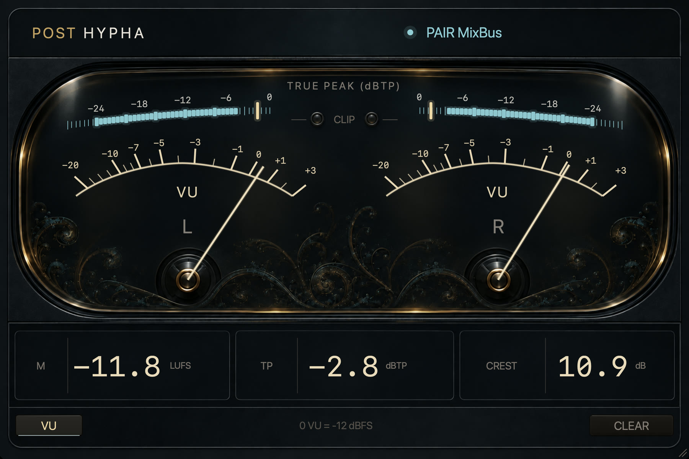
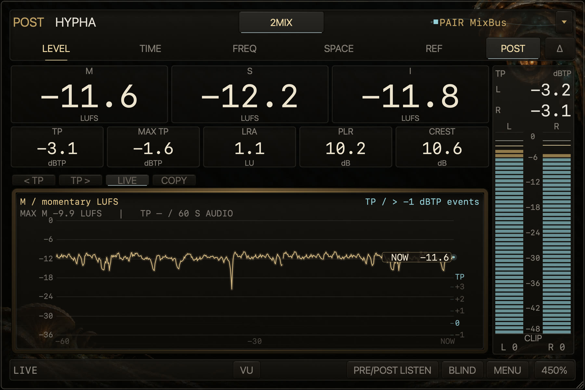
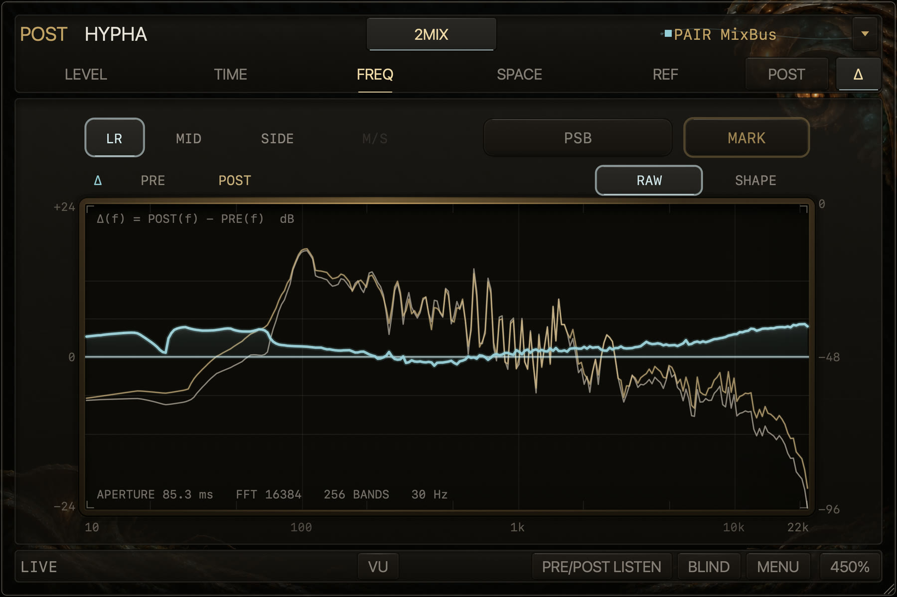
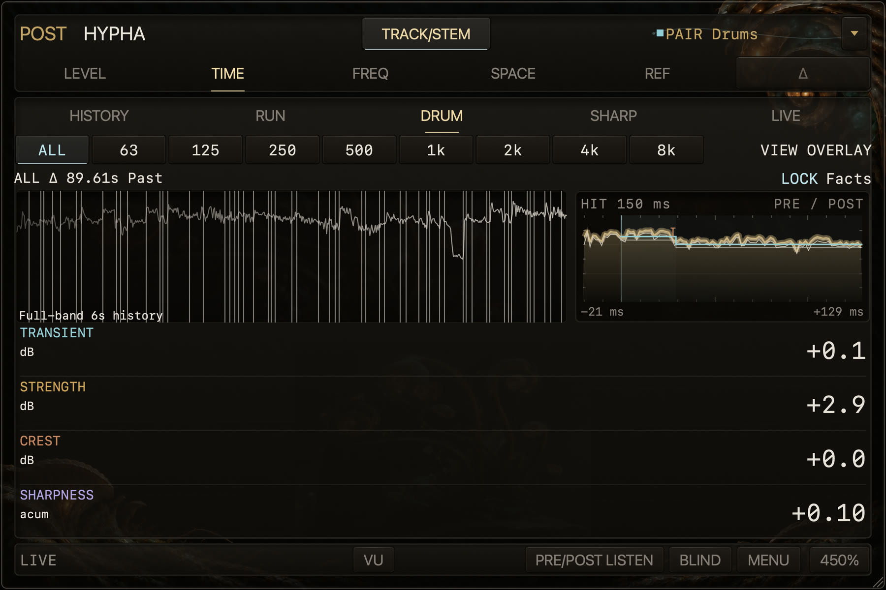
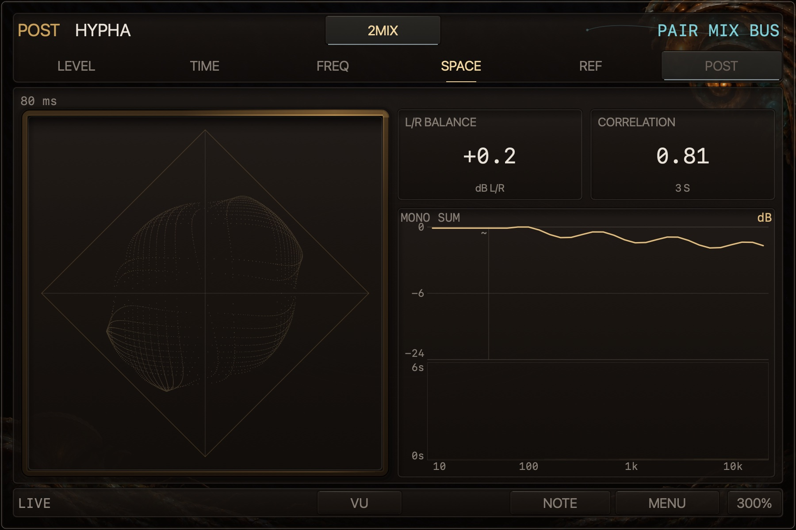
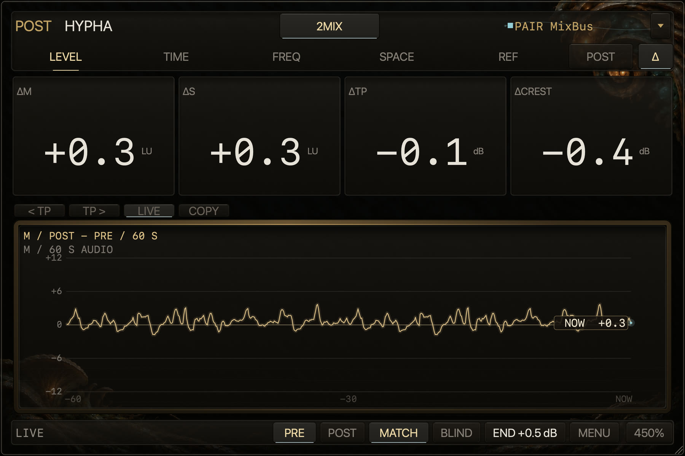
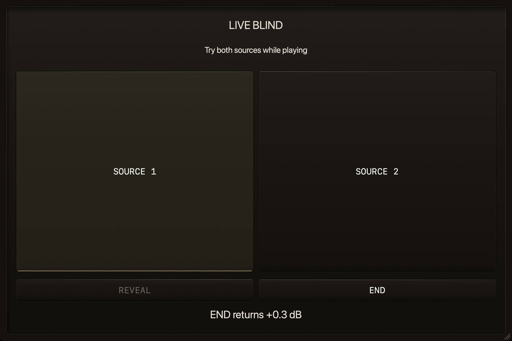
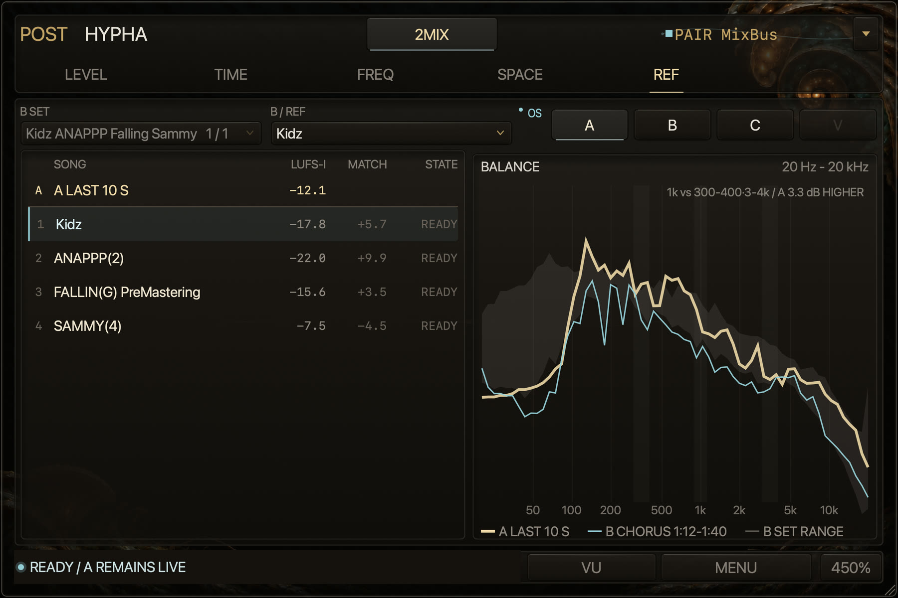
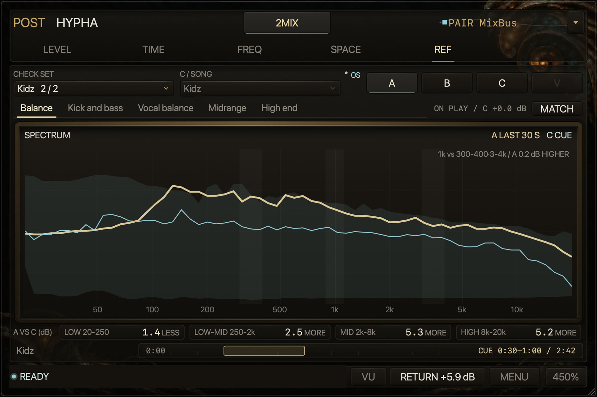
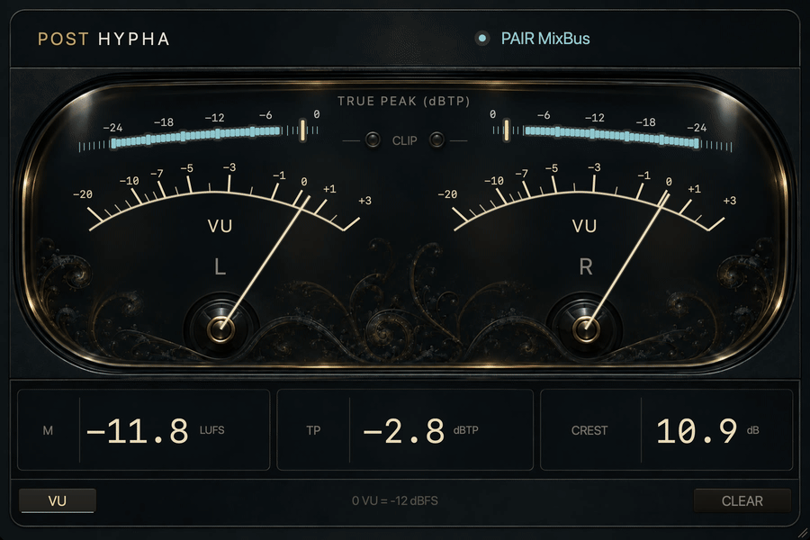

<div align="center">

# Kirin Hypha

### See the signal. Touch nothing.

Measure before and after your processing chain, see exactly what it changed, then hear both sides
at the same loudness — with the names hidden if you like.<br>
A free, open-source metering plug-in for macOS (AU · VST3 · AAX) and Windows (VST3 · AAX).

</div>



<p align="center">
<a href="#download"><b>Download 1.1.56</b></a> &nbsp;·&nbsp;
<a href="#start-in-under-a-minute"><b>Start in a minute</b></a> &nbsp;·&nbsp;
<a href="#what-you-can-do"><b>What you can do</b></a> &nbsp;·&nbsp;
<a href="#the-full-manual"><b>Manual</b></a> &nbsp;·&nbsp;
<a href="#building-from-source"><b>Build from source</b></a>
</p>

## At a glance

Kirin Hypha is a free, open-source metering plug-in in two parts, PRE and POST. PRE goes before
your processing chain and POST after it. POST shows its own readings or the difference from PRE
(Δ), and can play PRE and POST at matched loudness, also blind. In normal measurement the audio
passes through unchanged with zero added latency.

| Fact | Value |
|---|---|
| Price | Free |
| License | GPLv3 ([LICENSE](LICENSE)); the source is this repository |
| Latest version | 1.1.56 ([release notes](https://github.com/heyalohaloha/kirin_hypha/releases/tag/v1.1.56)) |
| Download | macOS PKG and Windows EXE under [Download](#download) and on [GitHub Releases](https://github.com/heyalohaloha/kirin_hypha/releases) |
| macOS | macOS 12 or later, Universal (Apple Silicon and Intel): AU, VST3 and AAX Native, signed and notarized |
| Windows | Windows 10 or 11, x64: VST3 and AAX Native in an Authenticode-signed installer |
| DAWs | A VST3 DAW, an Audio Unit DAW on macOS, or Pro Tools for AAX |
| Hosts with checked PRE/POST timing | Pro Tools (AAX), Logic Pro (AU), Studio One 6–7 / Studio Pro 8 (VST3) and REAPER (VST3); live comparison in Pro Tools uses 12.6 or later ([details](docs/manual/observation_domains.md#freq--where-the-chain-changed)) |
| Plug-in names | PRE Kirin Hypha and POST Kirin Hypha |
| Channels | Mono and stereo |
| Pairs | Up to 12 PRE/POST pairs per project |
| Kirin OS | Not required. Reference, Record and `plugin_data` output need a Kirin OS license ([kirinmastering.com](https://kirinmastering.com)) |
| Built with | A Rust measurement core and a JUCE plug-in shell ([Building from source](#building-from-source)) |

### Where PRE and POST go

PRE and POST are separate plug-ins. Insert both on the same track or bus, around the processing
you want to measure:

```text
PRE Kirin Hypha  →  your processors  →  POST Kirin Hypha
```

POST works on its own and measures the audio at its position. With a PRE in the chain, opening
POST's window pairs POST with the PRE when exactly one PRE in the project has no POST; track
position and names are never used to guess a pair. Each chain can have its own pair. To compare
two processors on one track, place PRE1 → A → PRE2 → B → POST
([A/B comparison](docs/manual/ab_compare.md)).

<table>
<tr>
<td width="50%" valign="top"><b>Touches nothing</b><br>
Normal measurement passes the audio through unchanged, with zero added latency. 64-bit
floating-point audio keeps its full precision.</td>
<td width="50%" valign="top"><b>Before and after</b><br>
PRE before your chain, POST after it, and they pair on their own. POST shows its own reading, or
the difference as Δ.</td>
</tr>
<tr>
<td width="50%" valign="top"><b>A fair listen</b><br>
Switch PRE and POST at matched loudness while the DAW plays — or blind. Listening starts only
when you choose it.</td>
<td width="50%" valign="top"><b>Open to inspection</b><br>
GPLv3. Every metric is backed by a known-signal test you can read and run.</td>
</tr>
</table>

<details>
<summary>Contributor guides</summary>

[Build guide](docs/hypha_build_entry.md) · [Release qualification](docs/hypha_release_entry.md).
Commands and prerequisites are in [Building from source](#building-from-source).

</details>

## Start in under a minute

1. Insert **POST Kirin Hypha** on a bus or master.
2. Open **LEVEL** to read loudness, true peak and crest. POST works on its own; Kirin OS is not
   required for real-time measurement.
3. To compare your processing, insert **PRE Kirin Hypha** before the processors and keep POST
   after them. With POST's window open, POST pairs with that PRE on its own and says **Paired with
   PRE**; **Unpair** is right there if you did not want it. When more than one PRE is free, click
   the badge at POST's top right, then choose that exact PRE under **PRE connection**.
4. Choose **POST** for the output's own readings or **Δ** for the difference from PRE. Explore
   **TIME**, **FREQ** and **SPACE** as you need them; **REF** compares references from Kirin OS.

Names are optional labels. PRE and POST do not need matching names, and track position is never used
to guess a pair. PRE captures the input state, while POST captures the output state and joins only
verified matching observations.

## What you can do

<table>
<tr>
<td width="50%" valign="top">

<br><b>Loudness now, and the last minute</b> · LEVEL<br>
Loudness (M / S / I), true peak, LRA, PLR and crest above a minute of history.
Click a moment to hold it while measurement continues; step through every peak above −1 dBTP.
</td>
<td width="50%" valign="top">

<br><b>Which frequencies changed</b> · FREQ<br>
PRE, POST and their difference in LR, MID or SIDE, with a six-second field and a Focus Trail for
any frequency.
</td>
</tr>
<tr>
<td width="50%" valign="top">

<br><b>How the same drum hit changed</b> · TIME / DRUM<br>
Every hit measured on PRE and POST: transient, strength, crest and sharpness, read as the median of
up to eight recent hits. Pick an octave band to compare each hit's delay, attack, release and level.
</td>
<td width="50%" valign="top">

<br><b>What survives the mono sum</b> · SPACE<br>
A fine stereo trace, balance, correlation, and how much of each band survives the mono sum.
This SPACE example uses synthetic stereo samples rendered by the current editor.
</td>
</tr>
<tr>
<td width="50%" valign="top">

<br><b>Louder, or better?</b> · LISTEN<br>
Hear the signal before or after your processing at a matched level, without stopping playback.
Unverified timing keeps POST audible; the same comparison resumes after fresh proof.
</td>
<td width="50%" valign="top">

<br><b>Decide with the names hidden</b> · BLIND<br>
Two anonymous sources at a fixed matched level. Switch while the DAW plays, then <b>REVEAL</b>
which one was PRE and which was POST.
</td>
</tr>
<tr>
<td width="50%" valign="top">

<br><b>Your mix beside your references</b> · Reference B (with Kirin OS)<br>
Rank your own reference songs against your mix (A) and hear each one at the same level, from its
chorus or your own cue, with the same spectrum definition.
</td>
<td width="50%" valign="top">

<br><b>A focused check on one cue</b> · Reference C<br>
Lay your mix over a chosen reference cue and read, band by band, where A has more or less. V
compares another version of the same song from the same place.
</td>
</tr>
</table>

<p align="center">

<br><sub>A tour: Hybrid VU, LEVEL, TIME, DRUM, FREQ, SPACE, LISTEN and PRE/POST Blind</sub>
</p>

In REF, drop an audio file to measure a target in the background, or use **MAKE TARGET** to save
the current A window (at least three seconds). Select it for C to compare its spectrum and Balance.
These targets contain measurements only and cannot play audio. Up to eight targets are kept in the
DAW project; audio and source paths are never saved. A Kirin OS license is required; registration and
measurement preparation in Kirin OS are unnecessary for these targets. File support uses JUCE's
basic formats: WAV, AIFF and FLAC; MP3 and M4A depend on the operating system.

Also inside: the Hybrid VU with true-peak bars and clip lamps, the SHARP and LIVE timelines, the
time your chain takes between PRE and POST, and a screen in English or Japanese.

**Free, and more with Kirin OS.** Everything above except Reference works on its own, free — up to
12 PRE/POST pairs per project. With a Kirin OS license, Reference compares your mix with your own
library, and Keep / Record saves a playback's measurements with the song. See [Modes](#modes).

## Download

**Hypha 1.1.56 is available for macOS and Windows.** Both installers include PRE and POST.

| Platform | Installer | Plug-in formats |
|---|---|---|
| macOS 12+, Intel and Apple Silicon | [Download Universal PKG](https://github.com/heyalohaloha/kirin_hypha/releases/download/v1.1.56/Kirin-Hypha-1.1.56-macOS-Universal.pkg) | AU · VST3 · AAX Native |
| Windows 10/11 x64 | [Download Windows EXE](https://github.com/heyalohaloha/kirin_hypha/releases/download/v1.1.56/Kirin-Hypha-1.1.56-Windows-x64-Setup.exe) | VST3 · AAX Native |

The macOS installer and plug-ins are signed and notarized. The Windows installer and plug-ins are
Authenticode-signed. Close your DAW, run the installer, then reopen the DAW.
[Installation details](#installation) · [Release notes, checksums, source and recovery ZIP](https://github.com/heyalohaloha/kirin_hypha/releases/tag/v1.1.56).

<details>
<summary>Download verification and release provenance</summary>

Download the latest macOS or Windows release from the [Releases page](https://github.com/heyalohaloha/kirin_hypha/releases).

The macOS installer package and the plug-in bundles inside it are signed with Apple Developer ID certificates and notarized by Apple, so Gatekeeper normally opens them without a warning. If a downloaded file is still flagged — for instance when the quarantine attribute persists — you can inspect it and clear the flag yourself:

```bash
# Inspect the installer signature
pkgutil --check-signature "Kirin-Hypha-<version>-macOS-Universal.pkg"

# Verify the download against the SHA-256 shown on the Releases page
shasum -a 256 "Kirin-Hypha-<version>-macOS-Universal.pkg"

# Remove the quarantine attribute if macOS blocks the installer
xattr -d com.apple.quarantine "Kirin-Hypha-<version>-macOS-Universal.pkg"
```

The installer package has companion `.pkg.sha256` and artifact JSON assets on the Releases page.
Each release also includes a signed, notarized macOS Universal ZIP for manual recovery. Use the PKG
for normal installation.

The Windows 10/11 x64 release is one signed installer EXE containing PRE and POST in VST3 and AAX,
built from the same release commit as macOS. The VST3 and AAX payloads, installer, and generated
uninstaller must pass their signature and acceptance gates, including pluginval, real DAW use,
same-version reinstall, upgrade from the preceding public release, and isolated uninstall.
[`docs/windows_external_validation.md`](docs/windows_external_validation.md) is the repeatable
real-machine regression checklist. Each release identifies its exact source commit and artifacts.

#### Release provenance

Published artifacts are immutable. If repository maintenance changes a public commit ID after a release, the commit recorded in that artifact remains its original build commit. [`docs/release_commit_map.json`](docs/release_commit_map.json) maps an affected artifact commit to the commit currently referenced by its release tag and records the verified source-equivalence scope.

Maintainers use the [public history identity contract](docs/public_history_identity.md): full commit
SHAs, SemVer tags, and PR numbers are authoritative; historical B numbers are supplemental labels.

</details>

<a id="optional-update-information"></a>
## Update information in 1.1.56

In 1.1.56, LISTEN and BLIND switch to PRE right away, even with a limiter or outboard gear (I/O
plug-in) between PRE and POST. When the audio cannot confirm where PRE is, Hypha plays PRE at the
DAW's clock position and aligns it once the audio confirms the timing. The
[release notes](https://github.com/heyalohaloha/kirin_hypha/releases/tag/v1.1.56) list every change.

**Automatic update checking is disabled in this release.** Use the Information menu's English or
Japanese official download link to get a newer version. Hypha does not install updates automatically.

<details>
<summary>Update-check implementation for contributors</summary>

The source contains an optional checker and offline tests. No production verification key or
published update service is provisioned, so this release hides update status, automatic checking
and Check now, and makes no update-check HTTP request.

When a future release enables the service, checks use one fixed official manifest and a shared
24-hour limit including failures and cancellations. Update storage is separate from Kirin OS
identity, Reference and Record data. Network, verification and storage work runs outside audio
processing; no installation, license, Work or audio identifiers are sent. Invalid, expired or
unsigned information cannot announce a release. Normal use works offline.

See [update implementation and acceptance](docs/hypha_update_check_contract_20261005.md) for the
protocol, clock handling, storage failures and service qualification requirements.

</details>

## Modes

| Feature | Standalone | With Kirin OS |
|---|---|---|
| Watch mode | ✓ | ✓ |
| POST on-demand DRUM / FREQ / SHARP / LIVE | ✓ | ✓ |
| Local PRE/POST Blind Compare | ✓ | ✓ |
| Live PRE/POST compare | ✓ | ✓ |
| Reference A · B · C · V and VERSION BLIND | — | ✓ |
| Record mode | — | ✓ |
| plugin_data output | — | ✓ |

Kirin Hypha is free, and everything without Kirin OS above works as a standalone plug-in. Reference and Record
mode require a Kirin OS license.

## Requirements

- macOS 12 or later (Apple Silicon and Intel)
- Windows 10 or 11, 64-bit
- A VST3-compatible DAW, an Audio Unit-compatible DAW on macOS, or Pro Tools for AAX

macOS delivers signed, notarized PRE/POST AU, VST3 and AAX plug-ins as Universal binaries. Windows
delivers PRE/POST VST3 and AAX x64 in an Authenticode-signed installer. The AAX plug-ins use Native
processing; AudioSuite is not included. Format availability and the feature-specific host timing
conditions in the [manual](#the-full-manual) are separate requirements.

**Not currently supported:** Linux · CLAP

## Design

Measured, not judged: Hypha reports what it captured. It sets no score, target or pass/fail of its own;
a target range on the Reference pages is the spread of the references you chose. During normal
measurement it does not generate, modify, attenuate, or delay audio. An explicit comparison audition
is a separate output-only path; it never rewrites the input, the captured PRE/POST measurements, or
Record data.

Every metric is backed by a known-signal golden test whose expected values are derived from the
signal definition and the ITU-R BS.1770 filter coefficients. The
[BS.1770-5 / EBU R 128 v5 measurement audit](docs/hypha_bs1770_5_r128_v5_audit_20260831.md)
records the verified scope, including all 70 assets of the EBU Loudness Test Set v05.
[Design and channel scope](docs/manual/design.md) has the full contract.

## The full manual

The manual is in [`docs/manual/`](docs/manual/). Each page starts with a short summary.

- <a id="channel-scope"></a>[Design and channel scope](docs/manual/design.md): what Hypha never
  does to the audio, display smoothing, the measurement audit, and mono / stereo scope.
- <a id="screen-language"></a><a id="keys"></a>[Screen language and keys](docs/manual/screen_and_keys.md):
  the English or Japanese screen and the keyboard shortcuts.
- <a id="observation-domains"></a>[Observation domains](docs/manual/observation_domains.md): LEVEL,
  TIME (HISTORY, RUN, DRUM, SHARP, LIVE), FREQ, SPACE and chain time, with the host clock rules for
  PRE/POST differences.
- <a id="what-it-measures"></a>[What it measures](docs/manual/what_it_measures.md): every metric
  with its window, unit and standard.
- <a id="installation"></a><a id="sandbox--privacy-audio-unit"></a>[Installation and Audio Unit sandbox](docs/manual/installation.md):
  install folders on macOS and Windows, what the installers remove first, and the AU file access.
- <a id="pairing-pre-and-post"></a>[Pairing PRE and POST](docs/manual/pairing.md): automatic pairing,
  choosing a PRE, names and duplicated instances.
- <a id="watch-mode"></a>[Watch mode](docs/manual/watch.md): the real-time display, the header
  buttons, small sizes and the Hybrid VU.
- <a id="live-prepost-compare"></a><a id="reaper-listen-timing"></a>[Live PRE/POST compare](docs/manual/live_compare.md):
  LISTEN, MATCH and AUTO, and the timing conditions in each host.
- <a id="local-prepost-blind-compare"></a>[Local PRE/POST Blind Compare](docs/manual/blind.md):
  BLIND with two anonymous sources and REVEAL.
- <a id="ab-hardware-and-plug-in-comparison"></a>[A/B: hardware and plug-in comparison](docs/manual/ab_compare.md):
  two processors compared with PRE1 → A → PRE2 → B → POST.
- <a id="reference-from-kirin-os"></a>[Reference from Kirin OS](docs/manual/reference.md): A, B, C
  and V, measured targets and Version Blind (Kirin OS license).
- <a id="record-mode-kirin-os-required"></a><a id="kirin-os-ecosystem"></a>[Record mode and Kirin OS](docs/manual/record.md):
  Keep, Stop, `.kirin` records and `plugin_data`.
- [Building from source](docs/manual/building_from_source.md): prerequisites, full-format builds and
  pluginval.
- <a id="maintainer-release-packaging"></a>[Maintainer release packaging](docs/manual/release_packaging.md):
  the signed PKG, the recovery ZIP, the Windows installer and the release gates.

## Building from source

```bash
git clone --recurse-submodules https://github.com/heyalohaloha/kirin_hypha.git
cd kirin_hypha
node scripts/build_hypha.mjs --without-aax
```

This quick build makes unsigned PRE/POST AU + VST3 Universal on macOS and VST3 x64 on Windows,
without the AAX SDK or iLok. It does not replace the full-format release gates.
[Building from source](docs/manual/building_from_source.md) covers the prerequisites, the
full-format build and pluginval. Contributors: read [CONTRIBUTING.md](CONTRIBUTING.md), the
[build guide](docs/hypha_build_entry.md) and [release qualification](docs/hypha_release_entry.md).

## License

[GNU General Public License v3.0](LICENSE)

Kirin Hypha is released under GPLv3 to keep the measurement layer auditable. The numbers a tool produces should be inspectable — any user, researcher, or engineer can read the code that generated them. Derivative works inherit the same openness.

Release downloads include the Corresponding Source archive and third-party license notices.
The archive retains the GPL-covered AAX SDK source used by the build. The PACE signature
verification component included with AAX is covered by its separate PACE terms; see the Legal
notices delivered with the installer and recovery ZIP.

## Acknowledgements

Built on [JUCE](https://juce.com). The legacy VST3 identity and state compatibility path uses
[nih-plug](https://github.com/robbert-vdh/nih-plug) by Robbert van der Helm.

*Kirin Hypha — observation, kept simple.*
