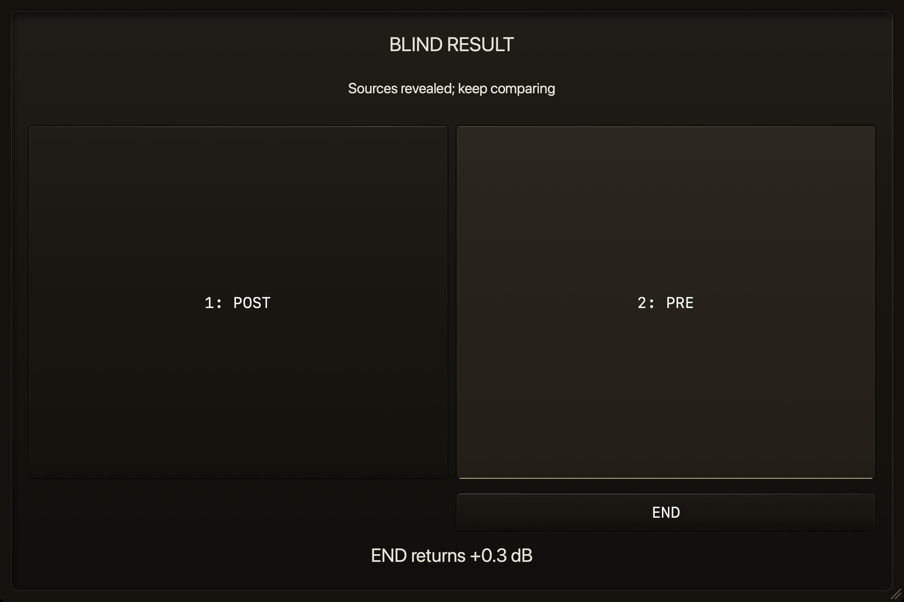

# Local PRE/POST Blind Compare

BLIND plays PRE and POST as two anonymous sources at a fixed matched level during live playback.
Switch SOURCE 1 and SOURCE 2, then REVEAL shows which was PRE. An optional preference trial lets
you choose the side you prefer over several rounds. No Kirin OS is required.

[Back to the README](../../README.md#the-full-manual)

**BLIND** is a live blind comparison, without Capture or rewinding. Press BLIND, keep the DAW
playing, and Hypha prepares a fixed level match. Switch **SOURCE 1 / SOURCE 2** as often as needed.
With **ROUNDS → 1**, once both have actually sounded, **REVEAL** shows the PRE/POST assignment
in one click, without a question or another playback. You can keep switching after reveal, or
press **END**. This is the existing BLIND flow.

## Preference rounds

Choose **ROUNDS 1× / 5× / 10×** near REVEAL in the BLIND screen. **1** is the default and keeps
the existing comparison without a question. MENU offers the same **ROUNDS** setting and stays in
sync with the screen. At small sizes where the screen control cannot fit legibly, use MENU instead.
You can change the count only before the first answer of that trial. After an answer, the control
shows progress such as **Round 3 of 5** and cannot be changed; you can choose again for the next trial.

With **5** or **10** selected, BLIND asks **Which do you prefer?** in both PRE/POST and A/B comparisons. After both sources have
actually sounded in the current round, choose **1** or **2**. An interval where a substitute
source played does not count as hearing the requested source.

The counter shows the current round, such as **Round 3 of 5**. Each answer starts a new, independently
randomized hidden assignment, while the matched gain and approval stay fixed. Hearing marks start
over for each round. The source number you have selected stays the same, but its hidden assignment
may change. If a random assignment cannot be prepared, Hypha stops rather than using a predictable one.

After at least one answer, you can press **REVEAL** without finishing all the rounds. An unanswered
round is not counted. After the final answer, Hypha invites you to reveal; it does not reveal automatically.
The result reports the number of times you chose PRE or POST (A or B in A/B), or the equal counts.
From two completed rounds onward, except when the percentage rounds to 100%, it also reports how often a preference at least this uneven would
occur when choosing at random, using a two-sided binomial calculation. This is a description of the
choices, not an assessment of the listener, an ABX identification test, or proof of better sound.

Preference answers and hidden assignments remain in memory for the current trial. END, restoring
saved plug-in state, or changing the pair, format or owner clears them; restoring state does not
resume a trial. Answers are not automatically written to disk, learned from, or used to change audio.
The round-count setting is remembered separately. A previous GUESS-on setting is read as five rounds
when no new preference setting has been saved.

**Details** opens the round-by-round choices. For PRE/POST, it also shows the approved level adjustment
when that adjustment is available. A/B shows the choices without inventing unavailable measurement
values. Details starts closed for each trial and is not included in the saved image.

**Measured during this blind** describes PRE-to-POST changes measured from the time BLIND starts
on the message thread until REVEAL. Only newly advanced measurement frames in that interval are
eligible. These are not records of the blocks you heard, or proof that you listened to a particular
source. PSR, CREST and SHARP differences use the accepted observation time for each value; values
with less than three seconds of usable observation are withheld with an explanation. Screen refresh
counts are not observation time. Frequency-band differences are not displayed in Details.

## Save an image

On the RESULT, **SAVE IMAGE** saves a 1080 × 1080 PNG where you choose. Name each source first, up to
16 characters; an empty name uses PRE and POST (A and B in A/B), and the names are remembered.
The image shows the source assignment, the preference count and random-choice proportion when
available, and the RESULT's existing notes, in the screen language. Saving the image is an explicit
export of that summary, not an automatic record of individual answers. It ends with **One blind listen
at matched level.** for one round, or **N blind rounds at matched level.** for two or more, and the
Hypha address. Song and track names are not collected automatically. When saving fails, the reason
stays on the screen.

Alternatively use **LISTEN → MATCH → BLIND**. A valid, fully applied MATCH is reused without
another measurement; AUTO stops and the gain is frozen. TP LIMIT is not a full match, and a MATCH
you turned off is not reused: BLIND then matches on its own.

BLIND matches by raising the quieter source, as long as it stays under the ceiling (the larger of
−1 dBTP and the measured true peaks). When raising it would peak above the ceiling, already at MATCH
or later in the song, BLIND matches on the quieter side instead: the raised source returns to its
own level and the louder one is lowered by the same amount, without a question. From that block on
the two sources stay matched, and the louder source never stands in for the raised one. The line
under the buttons then says why both are quieter and what END gives back, for example
**Lowered 2.0 dB to avoid clipping; END restores it**.
END ends the entire comparison, not a return to matched LISTEN. Any rise is shown before pressing
END and returns within half a second, at once while the DAW is stopped. Closing the window alone never raises the level.
A realtime bounce or export while BLIND is on records the source you hear, so press END first.
If restoring state leaves POST attenuated, use the displayed **RETURN +x dB** before
starting a new LISTEN or BLIND session. Only a still-active session can carry its own approved
attenuation into BLIND. A match outside the final ±24 dB range reports why it cannot start;
it does not remain in preparation without an explanation.

Live Blind compares different moments within one continuous playback; it does not claim identical
sample ranges, an ABX identification test, or proof of better sound. A confirmed loop may continue
the same trial across timing interruptions. Each unverified block plays POST, and fresh proof
returns to the same hidden assignment without END or reselection. A fallback is never counted
as hearing PRE; REVEAL adds one short note if a PRE interval used POST. An audio estimate that PRE
is late or has jumped never switches a source to POST: PRE keeps its clock position, a notice that
lasts three seconds reads the same for both sources, and RESULT says by how much PRE may have been
off, after the note on any POST that really stood in, even while the notice is still up. If no position is measured within the first second, PRE plays at
its clock position and the same line, **Delay unmeasured / Check delay compensation**, appears for
both sources. When an earlier LISTEN or BLIND with the same pair and format confirmed a correction,
PRE plays with it instead and both sources show **Delay not re-measured**. When seeks keep PRE from
reaching a correction of up to a second, POST stands in for at most one second in all, whatever the
reason PRE was not playing; these waits and lines come at the same time whichever source is selected.
Then PRE plays at its clock position with **Delay unmeasured** until it
can. When a delay changes during a trial, both sources show **Delay changed: hear both sources**
until you have listened to each of them for half a second: PRE takes the new position while the other source plays. A correction the host starts compensating itself is dropped. Source buttons show your selection, while internal played receipts count only the source that
actually sounded.

Restoring plug-in state also cancels the old trial and MATCH, even if the same PRE pair is restored.
Existing attenuation stays held; an END already requested continues to actual normal level.
The first detected interruption reason survives teardown internally. An actual LISTEN interruption
is explained once in the footer; at normal output level that notice clears after three seconds.
Pairing PRE or reopening saved settings alone does not show a listening warning. A later callback
cannot overwrite the retained reason or attribute an old failure to a new attempt. The notice
describes the detected condition, not an inferred fault in another plug-in.
Initial calibration and level preparation are quiet. LISTEN, MATCH and BLIND accept the request
and use fresh, complete evidence when ready. Short recovery has no WAIT, HELD or checking notice.
After three seconds without usable evidence, a brief reason and recovery action appear. END and
any held attenuation keep their existing explicit level-return controls.

Blind interruption and its first reason are committed together for the sampled trial; named PRE
selection uses the same command-bound rule, so a late callback cannot clear a newer selection.
Reference and its access panel follow the parent editor's current body bounds when a recovery
line appears or disappears. Unchanged geometry does not relayout those panes.
Meters, names, gain details and their accessibility are isolated until the comparison ends.
The signed 1.1.51 release has passed the one-pass/END flow and safe session reopen in REAPER 7.71
VST3 stereo on Intel macOS. That result does not establish the same acceptance in every format
or host configuration.

The header groups **TRACK**, **2MIX** and **REFERENCE** in that order. TRACK and 2MIX select
the measurement context directly. Blind inherits it when opened and keeps any override within that comparison.
**2MIX** identifies a mix or master bus and uses continuous active sections for Gain Match.
**TRACK** identifies an individual track and uses short or sparse event energy.
Hypha never infers or changes this choice from channel count, names, routing, or signal level.

Reference Version Blind is a separate whole-song
comparison between live DAW A and a measured, acoustically matched Version V from Kirin OS, shown on
the same screen as BLIND.
Its four-second A observation proves calibration only; it neither replaces live A nor claims
whole-song loudness or an immutable whole-song identity for the current DAW input.
