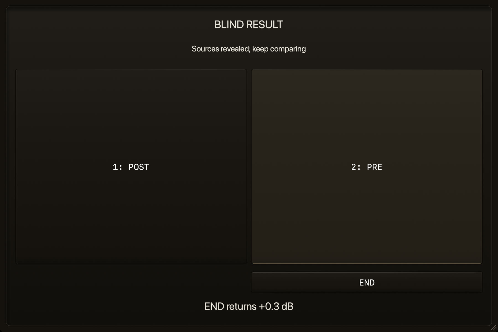

# Local PRE/POST Blind Compare

BLIND plays PRE and POST as two anonymous sources at a fixed matched level during one playback.
Switch SOURCE 1 and SOURCE 2, then REVEAL shows which was PRE. It needs no Kirin OS and stores no
answers.

[Back to the README](../../README.md#the-full-manual)

**BLIND** is a one-pass live blind comparison, without Capture or rewinding. Press BLIND, keep
the DAW playing, and Hypha prepares a fixed level match. Switch **SOURCE 1 / SOURCE 2** as often
as needed during that same playback. Once both have actually sounded, **REVEAL** shows the
PRE/POST assignment in one click, without a preference question or another playback. You can keep
switching after reveal, or press **END**. Live Blind does not collect preference answers, save a
vote, learn from it, or change audio from it. No Kirin OS is required.

Alternatively use **LISTEN → MATCH → BLIND**. A valid, fully applied MATCH is reused without
another measurement; AUTO stops and the gain is frozen. TP LIMIT is not a full match. If matching
requires lowering POST, approval names both the reduction and the rise on END before applying it.
END ends the entire comparison, not a return to matched LISTEN. Any rise is shown before pressing
END, ramped, and confirmed by the Audio Thread. Closing the window alone never raises the level.
If restoring state leaves POST attenuated, use the displayed **RETURN +x dB** before
starting a new LISTEN or BLIND session. Only a still-active session can carry its own approved
attenuation into BLIND. A match outside the final ±24 dB range reports why it cannot start;
it does not remain in preparation without an explanation.

Live Blind compares different moments within one continuous playback; it does not claim identical
sample ranges, an ABX identification test, or proof of better sound. A confirmed loop may continue
the same trial across timing interruptions. Each unverified block plays POST, and fresh proof
returns to the same hidden assignment without END or reselection. A fallback is never counted
as hearing PRE; REVEAL adds one short note if a PRE interval used POST. Source buttons show your
selection, while internal played receipts count only the source that actually sounded.

Restoring plug-in state also cancels the old trial and MATCH, even if the same PRE pair is restored.
Existing attenuation stays held; an END already requested continues to actual normal level.
The first detected interruption reason survives teardown internally. An actual LISTEN interruption
is explained once in the footer; at normal output level that notice clears after three seconds.
Pairing PRE or reopening saved settings alone does not show a listening warning. A later callback
cannot overwrite the retained reason or attribute an old failure to a new attempt. The notice
describes the detected condition, not an inferred fault in another plug-in.
Initial calibration and level preparation are quiet. LISTEN, MATCH and BLIND accept the request
and use fresh, complete evidence when ready. Short recovery has no WAIT, HELD or checking notice.
After three seconds without usable evidence, a brief reason and recovery action appear. END and
any held attenuation keep their existing explicit level-return controls.

Blind interruption and its first reason are committed together for the sampled trial; named PRE
selection uses the same command-bound rule, so a late callback cannot clear a newer selection.
Reference and its access panel follow the parent editor's current body bounds when a recovery
line appears or disappears. Unchanged geometry does not relayout those panes.
Meters, names, gain details and their accessibility are isolated until the comparison ends.
The signed 1.1.51 release has passed the one-pass/END flow and safe session reopen in REAPER 7.71
VST3 stereo on Intel macOS. That result does not establish the same acceptance in every format
or host configuration.

The header groups **TRACK**, **2MIX** and **REFERENCE** in that order. TRACK and 2MIX select
the measurement context directly. Blind inherits it when opened and keeps any override within that comparison.
**2MIX** identifies a mix or master bus and uses continuous active sections for Gain Match.
**TRACK** identifies an individual track and uses short or sparse event energy.
Hypha never infers or changes this choice from channel count, names, routing, or signal level.

Reference Version Blind is a separate whole-song
comparison between live DAW A and a measured, acoustically matched Version V from Kirin OS, shown on
the same screen as BLIND.
Its four-second A observation proves calibration only; it neither replaces live A nor claims
whole-song loudness or an immutable whole-song identity for the current DAW input.
