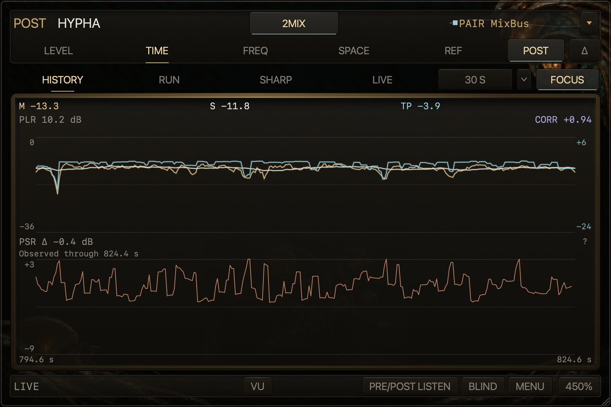
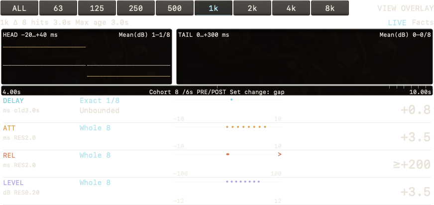
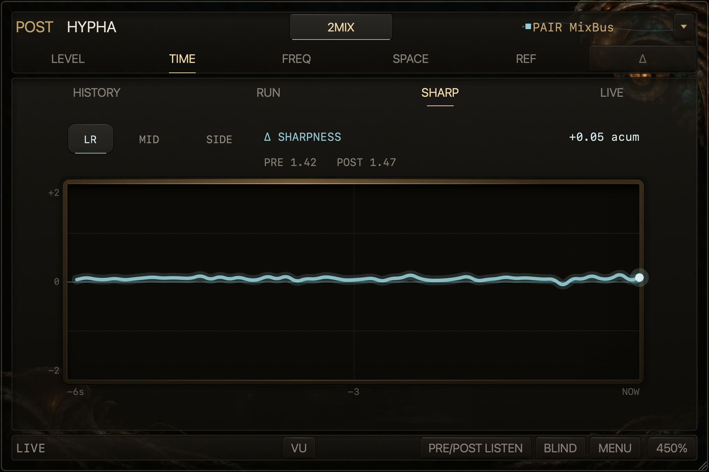
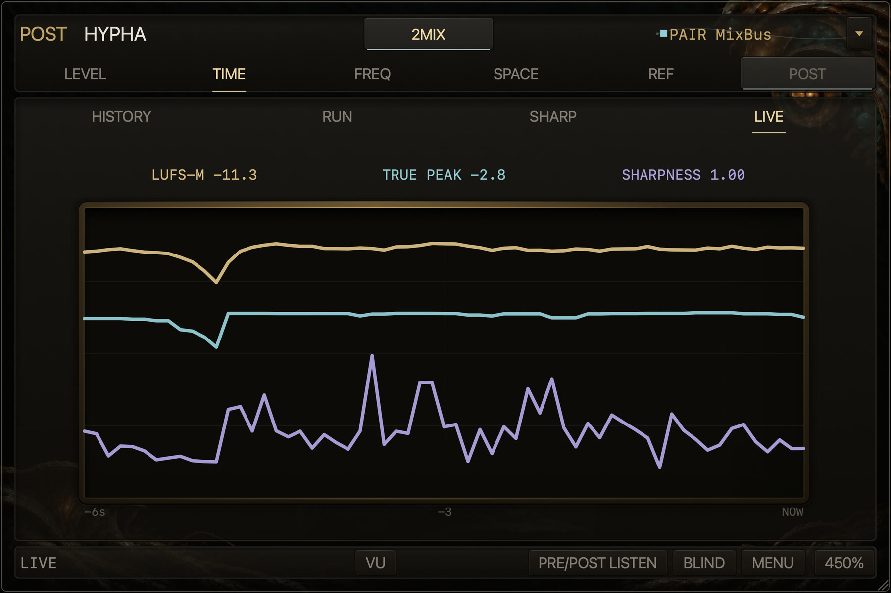

# Observation domains

The pages LEVEL, TIME (HISTORY, RUN, DRUM, SHARP, LIVE), FREQ and SPACE, and the chain time
between PRE and POST. Each section says what the page shows and how PRE/POST differences are
timed, including which clock each host supplies.

[Back to the README](../../README.md#the-full-manual)

## LEVEL — loudness, peak, dynamics, and meaningful history

LEVEL keeps immediate loudness and dynamics facts above fixed-scale history. The large view adds M,
S, I, five supporting facts, and L/R meters without changing the compact measurement definitions.

The footer at 150% and above distinguishes LIVE, HOLD, WAITING and BYPASSED; at 100% and 125% the
folded strip shows only the short states (WAITING, BYPASSED, FORMAT HELD). Notifications stay
in that established bottom status area, without covering the graphs or L/R meters. Longer text
is abbreviated to the available width; click the notice to read its full details. The loaded
version remains in the information menu, not in the narrow status rail.

At 600×400 and above, click a LEVEL history point to hold the display while measurement continues.
`< TP` / `TP >` select adjacent excursions above −1 dBTP; `LIVE` resumes scrolling without resetting
measurements. Only TP strictly above 0 dBTP receives strong local glow, always at its measured height.
`COPY` copies the selected TP and approximate host-clock window endpoint. `HOST ~` does not promise
project-timeline coordinates or an exact peak sample: this history ABI does not distinguish project
and render clocks. An unavailable host position is shown as `ELAPSED`, never invented as a DAW position.

## Chain time between PRE and POST

POST's information menu (click the **POST HYPHA** title) shows how long the plug-ins between PRE and POST took per audio block:
typical and peak milliseconds and their share of the block's own length. It is elapsed time, not
CPU usage, and only blocks in which PRE demonstrably ran just before POST on the same thread count;
otherwise the menu gives the reason. **Show in the footer** keeps the typical / peak share in view as
`CHAIN LOAD 31% / 70%` (at 100% and 125% in the bottom strip), highlighted when a block took longer
than its own length. It is off until turned on and applies to every POST.

## TIME — what happened and when

TIME directly selects **HISTORY**, **RUN** (absolute facts grouped by playback run within the
selected history), **DRUM** (per-hit attack, on a track or stem), signed **SHARP**, or three absolute
**LIVE** facts. Only the selected optional analyzer runs.

DRUM answers one question: **how did processing change the same hit?** Put PRE before the
processing chain and POST after it to compare POST − PRE; with POST alone, read the output hit's
shape and level. ALL gives the full-band view, and BAND focuses that comparison on a frequency
region. Adjust processing while LIVE shows incoming hits, then click a hit to LOCK and inspect
its observation. Return to LIVE to see the next change. LOCK fixes the displayed hit; it does
not loop or play audio. These readings
support listening; they do not rate sound quality or prescribe a compressor setting.

DRUM shows six seconds of the PRE/POST envelope and four facts for the selected hit:
**TRANSIENT** (first-30-ms RMS minus the body RMS), **STRENGTH** (first-30-ms RMS),
**CREST** (sample peak minus RMS in those 30 ms), and **SHARPNESS** (loudness-weighted perceptual
sharpness over the first 100 ms, in acum), each as POST − PRE. TRANSIENT describes the head/body
contrast, STRENGTH its initial level, CREST its peakiness, and SHARPNESS its perceptual sharpness.
A matched POST hit is measured at the PRE onset, so both sides read the same content samples. A TRANSIENT whose next hit leaves no 20 ms body,
or whose body is below the −72 dBFS HISTORY floor, shows **—**, with the reason in Facts. In POST, a locked hit can show
STRENGTH and CREST as soon as its first 30 ms are measured; TRANSIENT and SHARPNESS follow once its
body is complete. Delta values also require a complete PRE hit and verified mapping.
A hit cut off before those facts can be measured shows **—** and keeps its reason in Facts. Without PRE, the lanes show POST values.

**BAND**, on DRUM's second header row, filters each hit to one ISO octave band (63 Hz to 8 kHz) on
PRE and POST and turns the four lanes into **DELAY** (POST arrival − PRE arrival, where the band
envelope rises through its peak − 20 dB), **ATT** (10 → 90 % of the band peak), **REL** (peak →
−20 dB) and **LEVEL** (the peak of the band RMS envelope), each as POST − PRE of the same hit.
ATT and REL measure the hit's envelope, not a compressor's attack/release knobs. DELAY measures
the two band-arrival times, not the plug-in's reported audio latency. Larger views show the
hits on number lines. ALL and BAND LIVE use the latest eight completed hits inside the six-second
window. Audio, worker, publication and unverified mapping still pending are excluded before that
cohort is selected; older completed hits can fill those positions. Each lane excludes unavailable,
not-applicable and wholly uninformative intervals and shows a median from one or more informative
hits. With none it shows **—**. Facts keeps every cohort hit's classification, count and reason,
including the excluded observations. The UI never recalculates the median. Classification and
Age sentences and the repeated “Latest hit” or “Locked hit” lane text stay off the main view;
the existing LIVE/LOCK control and shared caption retain the selection context. Limits keep their direction and are rounded outwards. At 200 % and
300 % HISTORY shows those hits' average **HEAD** (−20 to +40 ms) and **TAIL** (0 to 300 ms) in that
band; smaller views keep the same values, units and Facts access in four cards. Click a dot (or use ← → HOME) to lock that hit and
read its own values and envelopes. LOCK keeps the selected hit when it leaves the visible window;
its completed values, envelope and original qualification stay together in one bounded snapshot.
A real source or clock binding change retires it. LIVE returns to its retained summary. ALL LIVE uses
the same completed-hit cohort as BAND; LOCK alone reads one selected hit. The band hits keep the same producer keys as the full-band navigation. Choosing
another band analyzes the retained last 7 s again, even while stopped; ALL releases the extra band
audio. Facts distinguishes silence, an earlier hit still ringing, a next hit cutting the tail,
unmeasured audio, audio/worker/publication still pending, and missing comparison proof. A measured
limit remains a limit on the production view; its reason and resolution remain in Facts.
An older PRE or a band mismatch keeps the requested Δ scope and preserves a reason such as
`Update PRE` or `No mapping`. It does not substitute POST values for an unavailable Δ. An absolute
POST snapshot is labelled POST, and its DELAY is not applicable (`No PRE`). Open **Facts** for the
same adopted values, subset medians, classification counts, per-metric age and measurement spans.

The BAND example uses synthetic measurements to show missing observations and measured bounds.

TIME's PSR has its own target and cutoff: it automatically shows Δ for a selected pair, while the
main POST/Δ choice still controls M, S, TP, PLR and CORR. TIME PLR belongs to its completed
100 ms point and uses that point's processed prefix; it does not include later pending input. A comparison that is waiting or expired
keeps the Δ label and its reason. It does not silently become POST. Current values expire from the
original 100 ms slot's completion: absolute readings last 400 ms. Matched LEVEL/TIME readings
remain active for less than 1 s while the same pair, source spans and clock run continue, and
while the local timeline lag is also less than 1 s. Polls and rejoins do not renew this deadline.
Seek, loop wrap, stop/pause, run, pair, authority or layout changes retire the comparison immediately.
FREQ uses its own spectrum freshness; LEVEL warming or delayed measurement does not hide its
Δ legend or MARK. Pair rejection reasons still appear in FREQ. A stopped POST keeps its selected PRE and reports
that comparison is stopped; it does not ask you to select the same PRE again. A PRE that stops
while POST continues is shown as inactive. Clearing the selection still reports no matching PRE.
After a playback boundary, current Δ requires a complete, continuous aperture on both sides:
400 ms for M, TP and LEVEL CREST, and 3 s for S, PSR and CORR. These LEVEL and TIME
readings also work when the DAW omits its optional presentation-latency report.
Absolute POST observations and Session statistics continue independently. A cumulative PLR
without equivalent prefix proof stays unavailable in Δ.
PSR is supplementary: its `Δ −3.3 dB` or `POST 10.1 dB` reading uses a small, regular-weight
font and secondary colour, with no equation beside it. M, S and TP remain the main readings.

DRUM reads incoming hits at 30 Hz, fetches ALL/BAND LIVE summaries at 4 Hz and adopts one complete
stamp every 500 ms. Values, counts, points, envelopes and Facts change together. Within one playback
pass, main numbers may retain their previous values while a nonempty cohort has newer unfinished hits;
an empty or wholly unavailable cohort otherwise shows **—**. After a loop wrap or seek, the previous
main readings and hit count stay visible in the secondary text colour, labelled **Previous**, until
completed hits supply replacements for the displayed readings in the same observation scope.
Their original POST/Δ meaning and units stay with them while waiting.
Measurement and the six-second history restart for the new pass; previous readings never enter its
medians, history or Facts. With no previous readings, the empty display is unchanged. HOLD retains
the last value; changing the band, explicitly changing the target, changing the pair, audio format or
comparison source, or restarting analysis clears previous readings. LOCK responds immediately. TIME updates at 10 Hz.
Its display clock is separate from measurement and stops where available observations end. The
view looks back 150 ms; a BAND reading older than 250 ms keeps its age and missing-data reason
visible in Facts. These readings describe the measured audio and do not judge its quality.

Meter Session I, LRA and MAX TP include every EBU-processed 10 ms block, including the tail before
Stop. During playback, the ordinary fraction of the next 10 ms chunk keeps MAX TP and PLR
available for the processed audio. A tail left unprocessed after Stop is reported explicitly:
MAX TP shows `≥` the confirmed value and PLR shows `---`. I and LRA describe the processed prefix. MAX M and current meter points keep their
100 ms update boundary. Reset clears the session; pause retains its coverage. Record semantics stay
unchanged. Capture freezes the displayed facts for a local PNG. If Work attachment v1 cannot retain
their typed meaning, attachment reports that limitation and offers the same frozen PNG for local save.
TIME HISTORY/PSR and DRUM require this typed meaning; RUN, SHARP and LIVE remain attachable in v1.
Saving over an existing PNG replaces it with the complete new image; it does not append a second
image. A failed write reports failure and preserves the previous file.

## FREQ — where the chain changed

AU FREQ Δ uses the same PRE/POST timing proof as LISTEN, in a separate render coordinate.
Certified Studio One / Studio Pro VST3 content clocks also use that proof. REAPER VST3
uses its certified, PDC-compensated project positions directly for measurement, without adding output latency. Complete matching windows from
the current run are required, and loss of proof clears the difference until fresh data is ready.
Other VST3 hosts retain their presentation-coordinate or project-timeline path, including FREQ
without an output-latency report; that path does not independently prove PDC content alignment.
If an uncertified VST3 host compensates the project position for a delayed insert and also
includes that same delay in PRE's output-latency report, the delay can be counted twice.
Hypha can then compare different parts of the audio and show a false Δ. Differences across a
delayed insert have not been verified in uncertified VST3 hosts.
The certified or checked host paths are Pro Tools AAX, Logic AU, Studio One 6–7 / Studio Pro 8
VST3, and REAPER VST3. The version policy and timing requirements below still apply;
this list does not mean every version or configuration has been tested.
The Studio Pro checks above were made on macOS and on Windows.
Mixed clock kinds are never compared. Missing latency is never treated as reported zero latency.

The cyan **Δ (POST − PRE)** curve is the primary view. PRE and POST remain visible as references.
Choose LR, MID, or SIDE; click a frequency to keep its exact six-second **Focus Trail**; use **MARK**
to retain one temporary full-spectrum reference. The display scale is ±24 dB.

## SHARP — how perceptual brightness changed over time

SHARP shows six seconds of signed **Δ Sharpness** in acum; without a paired PRE it shows POST's own
Sharpness. It reports observation only: no target, warning colour, score, or recommendation.

SHARP differences and PSB differences use verified PRE/POST timing in AU, AAX and certified
Studio One / Studio Pro VST3. REAPER VST3 also supports SHARP Δ and PSB Δ using
its compensated project positions (K = 0). At a loop wrap or position change, it discards the
previous analysis window and waits for complete matching windows. Other VST3 hosts retain their
output-presentation-latency requirement.
AU needs an independent host project timeline as well as the render timestamp. Logic AU
uses a common render coordinate only when the same callback also confirms the PRE−POST output
presentation-latency difference (including zero). This permits FREQ Δ, SHARP Δ, PSB Δ, LISTEN
and BLIND during Cycle. Project positions do not select a cycle occurrence: Logic can wrap
inside a block and move project time by one sample during pre-roll. Other AU hosts retain their
linear proof and positive-difference, observed-loop rule. With Cycle off, Logic also retains
project-based linear calibration when presentation reports are unavailable. An unproven AU pair waits; render time
alone never establishes alignment. During Cycle, an unverified AU pair shows **Turn Cycle
off to compare** in FREQ Δ, SHARP Δ and PSB Δ. LISTEN keeps POST playing with the same guidance,
and BLIND keeps its selection. Turning Cycle off allows fresh linear proof; the same BLIND
requires END and a new trial. Proven cycles remain available. LIVE, POST-only Sharpness and absolute PSB also accept the
project timeline or a local render clock, so they do not need an output-latency report; in AAX they
always use the project timeline.
Pro Tools AAX feeds SHARP through the Native engine clock. The difference uses the same PRE/POST
timing proof that LISTEN uses to play PRE: every Pro Tools build from 12.6 on proves it within the
documented delay-compensation bound, including an initial loop (the proof itself was measured in
Pro Tools Developer 26.4.0.5; other builds are certified by that floor, not measured). An AAX host
that is not Pro Tools proves it only during linear playback, so while Loop Playback loops a
selection there the view says **Loop Playback on: turn it off to compare**. After a start, seek,
stop/play, temporary clock gap, disabled delay compensation or another audition taking output,
affected views show **PREPARING ANALYSIS** until fresh proof and measurements are ready. Missing
latency is never assumed to be zero.

| Clock supplied by the host | LIVE / POST Sharpness / absolute PSB | SHARP Δ / PSB Δ |
|---|---|---|
| Certified Studio One 6–7 / Studio Pro 8 VST3 content clock | Available | Requires the existing LISTEN timing proof |
| AU render clock with independent host project timeline | Available | Requires linear or presentation-latency loop proof |
| Other VST3 output-presentation clock | Available | Requires a matching PRE; content alignment is not independently proven |
| REAPER VST3 compensated project timeline (all readable versions) | Available | Available; complete matching windows, PDC required. [LISTEN / BLIND conditions](live_compare.md#reaper-listen-timing) |
| Other project timelines without an output-latency report | Available | Unavailable (state 6) |
| Local render clock | Available | Unavailable (state 6) |
| AAX Native engine clock, Pro Tools 12.6 or later | Project timeline | Requires the existing PRE/POST timing proof (linear or bounded initial loop) |
| AAX Native engine clock, another AAX host | Project timeline | Requires the linear PRE/POST timing proof; waits while a selection loops |

REAPER differences rely on the host keeping project positions compensated for the audio. A reported
position or latency change clears the old windows immediately. If audio latency changes while all
clock reports stay unchanged, a brief false difference cannot be detected from those reports alone;
see the [measured REAPER conditions](live_compare.md#reaper-listen-timing). Plug-ins must report their latency and the host must compensate it.
The REAPER certificate covers all versions: the native executable must be named `REAPER` or `reaper`,
and its non-empty version string must start with an ASCII digit. Missing or unreadable versions,
other executable names and other formats receive no REAPER certificate. FREQ already relies on
compensated project positions across REAPER versions; SHARP and PSB use the same assumption.
Real-host checks used REAPER 7.71: FREQ, SHARP and PSB differences were zero during normal playback,
loops and latency changes during playback. This does not claim testing every version.

This table describes the analysis clock gate. It does not replace acceptance tests in each host.

SHARP Δ and PSB Δ follow the clock table above. AU, AAX and certified Studio One / Studio Pro VST3 wait
for fresh pair proof. REAPER VST3 uses its measurement-only project certificate. Other VST3
hosts without output latency use ABI state 6, showing a fixed
unavailable reason. LIVE, POST-only Sharpness and absolute PSB use the available local clock without this
requirement.
Switching views retires the previous view's missing-latency flag. Format support alone does not
prove PRE/POST timing alignment.

## LIVE — three absolute POST facts on one timeline

LIVE overlays POST **LUFS-M**, **recent True Peak**, and **Sharpness** on one six-second time axis.
Each metric keeps an independent fixed scale, and the current values update at a readable rate.

## SPACE — stereo distribution, and what the mono sum keeps

SPACE draws a fine stereo trace from the latest **80 ms** of this instance's original input,
with a **60 Hz** display refresh. Vertical motion is sound shared by the channels; horizontal
motion is their difference. The plot keeps continuous sample coordinates and subpixel points,
without MID/SIDE labels or a FIELD badge. Point at it for a one-line explanation, in either language.

The display tap runs only while SPACE is visible, on PRE and POST alike. It publishes each audio
block without waiting for the 100 ms meter publication, clears on seek, stop, bypass, offline
render or a callback gap, and resumes with fresh input. AU render-clock jumps and Reset also start
a fresh trace when transport information is unavailable. Restoring a minimised native window resumes
SPACE automatically. Mono input leaves the stereo plot empty and keeps its mono reason visible.
The dark frame and background stay fixed.
AAX split callbacks retain the full trace after the engine clock and an exact project-position
step verify their chunk. Seeks, Reset and missing clocks discard that proof and recover automatically;
Record keeps the host's original positions.

**BAL and CORR still use the same three-second statistics.** The public FIELD remains the same
25×25, three-second density; Record, Keep, Capture's measured density, saved state and the values
sent to Kirin OS are unchanged. The fast trace is display-only, uses a preallocated lock-free
copy, and never changes the audio or the measured facts. SPACE stays absolute: Hypha does not
invent PRE/POST subtraction for correlation or the stereo field.

At the largest editor it also shows **MONO**, beside the full-height scatter and under BAL and
CORR: how much of each third-octave band survives being summed to mono. One correlation figure is one number for the whole signal, and a stereo problem is
never spread evenly across the spectrum — it is a bass note, or a band an M/S move widened, or a
pair of channels that ended up out of phase somewhere. MONO says which band, and by how much.

Mid and Side are built in the time domain before the transform, so a phase cancellation is already
in the magnitude and the figure is what the band actually loses, not a width estimate.

Identical channels read 0 dB and a hard-panned source exactly -3.01 dB, and those two are the ends
of one range: while a band's channels share polarity, its reading cannot fall below -3.01 dB,
however wide the band is. A reading past -3.01 dB means the channels are partly opposed there, and
a band that cancels outright falls to the floor. The scale is split on that: the top half carries
0..-6 dB, which is every same-polarity reading and the margin around it, and the bottom half
-6..-24 dB, which is cancellation. A band with nothing to measure breaks the line rather than being
drawn at 0 dB, which is the one reading that means the band loses nothing. Below the frequency where one observation holds fewer than three
cycles, a divider and a tilde say so without hiding the values.

Under the curve, six seconds of the same bands run bottom to top: the newest observation along the
bottom edge, rising as it ages. A cancellation that came and went is visible after it has gone.
Those six seconds live in the editor, so closing it loses them; per-band history is not written to
the TIME history or to Record.

MONO is measured on both PRE and POST, so the two can be compared by switching between the
plug-ins. It adds no analyzer, consumes no analysis slot, and runs whether or not SPACE is open.

Two POST optional analyzers may stay active: one can remain on the 2MIX while the other follows the
working track. A third identifies the owners and waits until one of them leaves DRUM, FREQ, SHARP or LIVE for
another view, or closes.
