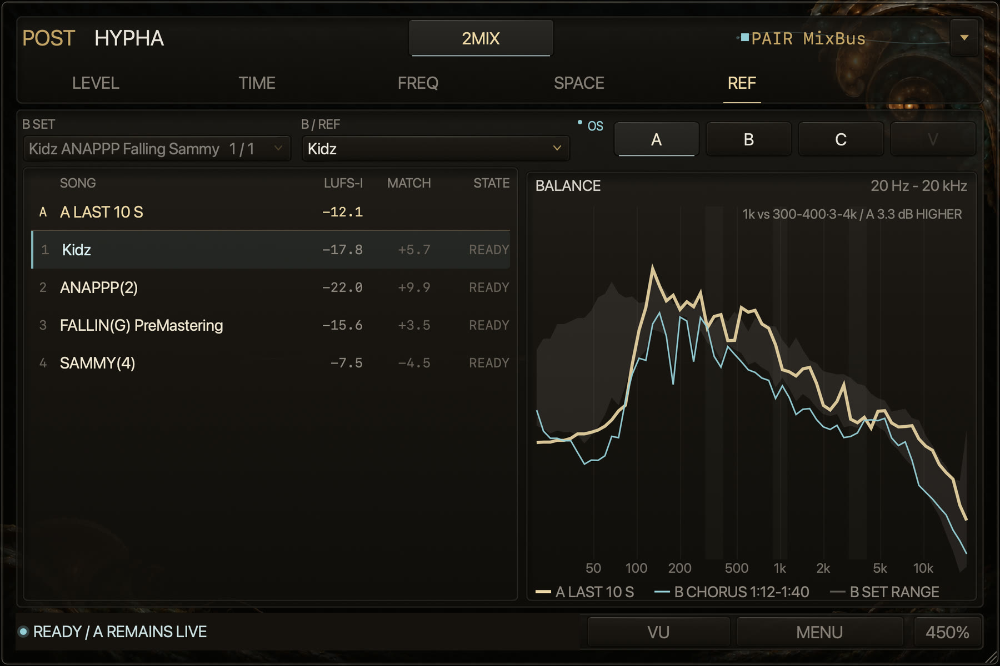

# Reference from Kirin OS

With a Kirin OS license, POST compares your mix (A) with Reference songs (B), a Check (C) and
another Version of the same song (V), heard one at a time at matched level. This page also covers
measured targets, Version Blind, the Reference pages and level approval.

[Back to the README](../../README.md#the-full-manual)

Kirin OS automatically publishes its saved Reference library to POST; there is nothing to
connect. A small OS indicator reports the connection; received settings remain visible when media is unavailable. Hypha does not substitute
its own Factory library. POST tells Kirin OS which library it has read and which items it left out.

Reference has four roles, each with its own button in the same place at every size: **A B C V**.

- **A — LIVE**: the DAW input. A is never processed; audible comparisons use audition copies.
- **B — REF**: Reference songs from Kirin OS. Rank up to three Reference sets for Hypha in Kirin OS;
  choose the set and the song on the B page. A song plays its Cue as Kirin OS set it and repeats it: the
  Cue's head is placed at the DAW position where you chose the song, B moves with the DAW from there, and at
  the Cue's end it continues from the Cue's head. Pressing B inside that repeating Cue joins it where it is, so
  B can start in the middle of the Cue. When you press B, or B returns after a stop or seek, at a point
  outside it (before where you chose the song, or past one Cue length when Kirin OS did not mark the Cue as a
  loop), B places the Cue's head at the current position instead of refusing. If a chosen song leaves
  the Reference set, Hypha says so instead of switching to another song. If Hypha cannot read a
  Reference set (for example from a newer Kirin OS), the B page asks to update Kirin OS and Hypha; the sets it can read
  stay usable, and while Kirin OS is publishing new sets the current ones stay.
- **C — CHECK**: a Check from a CHECK set (also ranked in Kirin OS, up to three). A Check names what
  to listen for; its songs are the CHECK set's, or the first-ranked Reference set's when the CHECK set
  has none (Kirin OS chooses them). The Cue is the section C plays.
  C can also compare a measured target containing numbers only; its DATA ONLY label replaces the play button.
- **V — VERSION**: another Version of the same song, aligned to A's position by its content.

**LOOP and FOLLOW A.** B and C play in one of two ways, chosen with **LOOP** and **FOLLOW A** on the B and C
pages; one choice serves both, and the project remembers it.

- **LOOP** (the default): B and C repeat a section chosen in Kirin OS (the Cue), as described above; they do
  not follow A's position in the song. The status line names the section that plays, for example
  **B CHORUS 2:53-3:07 LOOP**, and then how its level is held, for example **LEVEL FOLLOWS A (LAST 10 S)**. To
  hear another section, change the Cue in Kirin OS.
- **FOLLOW A**: B and C play the whole reference song from A's position in the DAW, so pressing A, B and C
  switches the sound at the same position, through seeks, stops and loops. The status line says
  **B FOLLOW A**. The offset moves the song against A when it does not line up: **+** and **-** move it by
  0.1 s (with Shift, 0.01 s; hold to repeat), and pressing the amount returns it to 0. A positive amount plays
  the song ahead of A. The offset returns to 0 when the song changes or when you press another role.
  The level is matched once, when you press B or C: the whole song's Integrated loudness from Kirin OS
  against A over its ALL window (up to the last 10 minutes), and then held (it does not follow A). The
  status line says **WHOLE SONG MATCHED TO A (ALL), FIXED**. The ceiling, the shortfall at the peak limit
  and LOWER A work as in LOOP. Before a press, B's list shows the MATCH gain only for the chosen song,
  whose whole-song value has arrived; C's readout uses the whole song too.
  When A's position with the offset is outside the song, A plays and the status line says why, for example
  **B PAST SONG END, A PLAYING / MOVE A BACK OR CHOOSE LOOP**; a role that was playing comes back by itself
  when A is inside the song again.

Switching while B or C plays moves it to the new position with a short crossfade (A plays for the moment the
new position takes to load), and its level is matched again by the new way's rule. Choosing or restoring a
way never starts a role. V always follows A's position by its content, and Blind is unchanged.
  V works best with Hypha on the 2Mix.

**Measured targets.** Drop a file onto REF to measure its whole length on a worker, including files
longer than ten minutes. The current comparison keeps showing during analysis; CANCEL discards the
pending import. MAKE TARGET copies the current A display window once it contains at least three
seconds. Select a saved target from TARGETS to compare it on C; it has a spectrum range and Balance,
with no audio to audition. On the B page, ALL also overlays targets with the Reference set's songs. The project stores up to sixteen targets in the order added: 64-band p10, median and p90,
four-band Balance, Integrated loudness, maximum True Peak, name, duration and channel count. When a
drop holds more files than there are free places, they are measured in the order dropped until the
places are full, and the rest are not added; nothing already saved is removed on its own, and REF says
how many were not added and that removing one makes room (3 NOT ADDED: 16 TARGETS MAX / REMOVE ONE TO
MAKE ROOM). Hypha 1.1.55 and 1.1.56 kept up to eight: they read the first eight of a project with more,
and saving the project there keeps only those eight.
Comparisons normalize the loudness channel sum to A's layout; the original measurements stay intact.
The saved A window starts with fresh K-weighting state, matching a file of that window. Audio and source paths
are not stored, and no target is written into Kirin OS. The Kirin OS license is required; its library
registration and measurement preparation are unnecessary for these targets. Remove a selected target
with the minus button.

Only one role sounds at a time. The A/B/C/V buttons change the sound; pages within Reference change only the
display. Leaving Reference returns to A with a short fade and cancels pending playback. The selections remain,
and reopening Reference does not start playback. Blind keeps its existing exit behavior. Choosing a different
Check, Cue or Version changes only that role: if it was playing, it fades to A and plays the new choice with a new
MATCH as soon as it is ready; the other roles keep playing. Choosing a different B song keeps the current song
playing while the new one prepares, then crosses directly to it with its own MATCH, without passing through A.
The pressed row is selected at once and PLAYING moves when the new song is actually heard. While the B page is
open, Hypha checks the listed songs ahead of a press, up to 8 songs and 1 GB. If a song cannot be prepared or
matched, the current song keeps playing and the status line says why; the choice completes by itself when it can.
Receiving or restoring settings never starts a role.

**Level matching.** B and V follow A: every second Hypha measures A's gated loudness over the last
10 seconds (BS.1770 gating of the 100 ms momentary history) and moves the audition copy toward
"A − the source's level" with a 50 ms ramp, ignoring changes within 0.5 dB. B uses its Cue's
Integrated loudness from Kirin OS (the whole song when the Cue has no value); V pairs A with the
aligned V content over the same window. Following never raises the copy above
max(−1 dBTP, A's maximum true peak, the source's maximum true peak): at the ceiling it stays there,
keeps following and says how far under A it plays. Following stays within 6 dB of the gain of
that MATCH (the same range as AUTO in the live PRE/POST compare), except lower when the ceiling
requires it. At either edge it keeps following; a difference over 0.5 dB appears as a short status
tag (2.0 DB UNDER A / OVER A (FOLLOW LIMIT)). It automatically matches again when the level returns
within range, using the same MATCH. Only the audition gain changes: A, measurements and Record stay
unchanged. C compares A's gated loudness over
the Cue's length (at least 10 s, at most 10 minutes) with the Cue's Integrated loudness. Pressing C
plays it at once, matched to the A heard so far, and when A has played for the Cue's length (at most
30 s) C matches once more and stays fixed, so that a fixed gain is not set from a few seconds; until
then the status line shows how much of A it has (C MATCHING A 12 OF 30 S). C waits only while there
is no A level at all. **MATCH** on the C page matches again from the current A window. A match without
enough A keeps the current gain and says why. A Check set to original level in Kirin OS plays as is.

**Lowering A to match.** A loud master and a quieter reference cannot be matched by raising the
reference past the ceiling. Pressing the role still plays it: Hypha raises it to the ceiling and the
status line says how far it is under A (2.4 DB UNDER A (PEAK LIMIT)); following and MATCH again do the
same. When the difference is more than 0.5 dB, the page of that role also offers to lower A by the
difference with a button (LOWER A 8.0 DB) at 300 %. The reference then plays at its own level and A
is lowered to it. Nothing is lowered without that press. A stays lowered after the audition, through the other
roles, until RETURN in the footer; RETURN stops the role and raises A over half a second. The roles'
readouts then name the gain against the lowered A, and RETURN in the footer says how far A is lowered
(the status line says it below 150 %, where the footer has no RETURN).
Offline renders and host bypass are never lowered, and the measurements and Record are taken before
it. While A is lowered, pressing LISTEN or BLIND returns it first and then starts, so POST is never lowered
twice.

**One comparison takes POST at a time.** Every button and every internal start asks the same rule:
a Blind or Keep waits while B, C or V plays (press A in REF first); other auditions wait while the live
PRE/POST compare holds or returns POST; and B, C, V or a Blind takes over a running live compare
session, whose PRE then needs selecting again. Keep remains available during held LISTEN attenuation
when no Blind owns the output; it records the canonical measurements before that attenuation.
A refused start says why and changes nothing.

A stop or seek keeps the selection: the same source returns at the same gain once it is ready again,
as in the live PRE/POST compare. An offline render, a local Blind or starting the live PRE/POST
compare clears that held selection, so nothing returns on its own afterwards. Sample-rate conversion
of the audition copy is automatic (the source file is never changed). On B, C and V (and Version Blind), a mono source on a
stereo track plays its one channel on both sides, unchanged. Two equal channels read 3.01 LU louder
(BS.1770) than the mono file Kirin OS measured, so MATCH, following and the gains shown before the
role plays add 3.01 LU to Kirin OS's value; the LUFS-I figures still show Kirin OS's value. A stereo
source on a mono track is not mixed down: the role says so and A stays live. Lowering A for a Blind whose
match exceeds the ceiling still requires explicit approval. Offline render, a missing or changed
source, or a failed check leaves A playing.

**Status.** The status line says one of three things, with a dot: ready (cyan: what plays
and how its level is held — following A, held at a limit with its remaining difference, matched
and fixed, or original level), waiting (gold: what it waits for and how it proceeds, such as playing the DAW), or
unavailable (grey: the reason and its one fix, such as ranking a Reference set in Kirin OS). Its parts are in
order of importance — how the role plays, how far it is under A, then the rest — and where the line is
narrower than all of them it shows the parts that fit whole instead of cutting one; pointing at a
shortened line shows it whole across the footer row. At 150% and
above it sits at the bottom left of the footer on every Reference page, where the other pages show
LIVE or HOLD, so the charts keep that row; at 100% and 125% it is the bottom row of the page. A
notice in the footer takes its place while it shows; when the line carries an approval or VERSION
BLIND, the line moves back to the bottom of the page instead, so neither is hidden. A role that
cannot be heard yet is drawn dimmed but stays clickable and explains itself. A wait never runs on
silently: past its limit (Kirin OS answering, 5 s; checking, loading or preparing a source, 10 s;
alignment, 30 s of play; A's level for MATCH, 10 s of play, or 35 s for C) it turns unavailable with
its reason and fix, shown even under the start guide, and returns to ready once the source is. While
Kirin OS prepares the song of a Reference set or CHECK set, the line says what Kirin OS is doing in its own
terms — how many songs it prepares first, checking the file, waiting for another measurement — and a
file Kirin OS cannot find turns the line unavailable with the retry as its fix (Kirin OS publishes
this beside its heartbeat; nothing is shown once Kirin OS closes). Blind keeps its own line and never
says which source plays or how it is matched. Pressing a role while it is still preparing
(publishing a new choice, verifying, loading or aligning its source, or measuring A) waits for it
and plays it as soon as it is ready, as when you press it while the DAW is stopped; a step only you
can change (outside the Cue, no match in this passage) or a match that cannot be made is explained
instead.

**Pages.** Each role has its page at 300% (900×600) and above. Below 300%, C and V are drawn dimmed; pressing
them opens 300% without changing the sound (press again to listen), as Blind does. At every size, 100% too,
the B page chooses the Reference set and the song, also while A plays, and switches FOLLOW A beside the song.
At 300% LOOP, FOLLOW A and the offset sit above the B song list and in C's Cue row.

- **B**: the songs of the chosen Reference set on the left (number, title, Cue LUFS-I from Kirin OS, the
  current MATCH gain of the playing song, and PLAYING / READY, or for a song being prepared what Kirin
  OS is doing: 2 AHEAD, CHECKING, WAITING or NOT FOUND) and **Balance** on the
  right: A over its window, 10 seconds unless you choose another (gold), the chosen song (cyan) and the set's p10–p90 range, each
  song shifted to the level B plays it at. No genre curves are supplied. B plays and is measured over
  its default Cue: for a song left on the whole track in Kirin OS, that is the chorus candidate, or the
  loudest 30 seconds when no chorus is found; the legend names the part and its times
  (B CHORUS 1:02-1:24), and the C page legend names C's part the same way. The list starts with A's row
  (its last 10 seconds, gold) and shows, for every prepared song, the gain MATCH would play it at; the
  playing song shows the gain applied. The legend's TARGET RANGE is the band between the set's songs
  (p10 to p90 per band, each at the level B plays it at). It takes two songs with measured values; with
  fewer there is no band and the legend does not name one.
  **ONE / ALL** at the top right of Balance chooses what it draws. ONE is the view above. ALL draws A
  (gold) with the lines you show: each row's number becomes a box that shows or hides that row's line,
  as many at once as you like. It only changes the chart; B still plays the one song you chose. The first
  ALL shows every song of the set. A line keeps the colour it was given until you hide it, whichever
  others you show or hide, and a box takes its line's colour. The legend names the lines shown in up to
  three rows and ends with how many more (+12). Pointing at a row, or near a line on the chart, draws that
  line stronger and the others fainter and reads A and that line at the pointer. In ALL the measured
  targets you dropped follow the songs, in the order added, at the level B would play them at (state
  DATA); pressing one to hear it says that it has no audio. In ALL, **LINES / SHAPE / ALL SHAPE** beside
  ONE / ALL chooses how the chart draws them, and the one that is on is lit. LINES draws each line
  turned on. SHAPE draws, instead of those lines, their mean and a band from the lowest to the highest
  value in each band; the numbers still choose what goes in, and the legend counts them (MEAN OF 3,
  RANGE OF 3). ALL SHAPE builds the same mean and band from every song of the set and every target,
  whatever the numbers say (MEAN OF ALL 20). With one item the band closes onto its line; with none,
  the chart says to turn songs on. A stays its gold line on top, and pointing at a row draws that one
  item's line thinly over the shape. The list scrolls when its rows do not fit, and moves to the chosen
  song. ONE or ALL, how ALL draws and the lines shown are saved with the project (earlier versions of
  Hypha ignore them). Below 300 % there is no Balance, so no ALL.
- **C**: CHECK SET with its rank ("1 / 3"), the song, the Checks as tabs in the set's order (a tab
  keeps the song; a set holds at most six Checks in Kirin OS, so the tabs fit one row at 300%; an older
  set with more Checks takes two rows rather than cut the names), the Cue, and MATCH. The comparison is the Cue, with its p10–p90 band as TARGET RANGE, against
  A over its window, the Cue's length unless you choose another; below it, the four-band Balance difference (20–250 Hz, 250 Hz–2 kHz, 2–8 kHz, 8–20 kHz) under
  the heading A VS C (dB) (CよりA（dB） in Japanese), read as 3.7 LESS or 0.5 MORE (3.7少ない, 0.5多い),
  and the Cue's place in the song with its loop and the playing position (in FOLLOW A, the whole song with
  FOLLOW A and the offset). A Check
  that looks at dynamics, loudness, stereo, waveform or transient compares range strips: for each
  fact, A (gold) and C (cyan) bars from p10 to p90 of the window with a mark at the median, and the
  medians on the right, with the difference on A's line — crest (TP/RMS) and loudness movement (LUFS-S around each median,
  read as p90 − p10) for dynamics, LUFS-M for loudness, width (S/M) and correlation for stereo, peak
  and RMS for waveform, and attack (each hop's peak minus its LUFS-M: how far the peaks stand out,
  made smaller by limiting) and onset for transient. The facts are Kirin OS's per-hop definitions
  (crest 20·log10(TP/RMS); width √(mean S²)/√(mean M²) × 100, up to 150 %; correlation
  ΣLR/√(ΣL²·ΣR²); LUFS at the end of the hop), so A's 100 ms bins are regrouped into C's hop
  (200 ms for a song longer than 204.8 s). Loudness facts (LUFS-M, peak, RMS) are shown at the level
  C plays at. Until A has 3 seconds only C is drawn (A WAITING).
  Every difference on B, C and V is said with A as the subject and a word instead of a sign:
  A 0.12 LOWER,
  A 10 pt NARROWER, A 1.2 LU QUIETER (Aが0.12低い, Aが10 pt狭い, Aが1.2 LU小さい), and A SAME AS C
  (AはCと同じ) when it rounds to zero. The metric cards read A, C and A VS C (CよりA) with the size of
  the difference and its unit and word under it (1.2 / LU QUIETER); at 200 % and below each card is one
  line, LUFS-I A 1.2 LU QUIETER.
- **V**: the Version (across the whole row), then the tabs WHOLE, TONE, DYNAMICS, STEREO and LOW END
  (全体・音色・ダイナミクス・ステレオ・低域). V's items are fixed and separate from C's CHECK SET, whose
  Checks each come with their own reference songs (comparing Versions of the same song needs no
  CHECK SET). WHOLE is the song timeline: A above V,
  peak outside and RMS inside, only observed A regions drawn and older passes dimmed. Select a region
  for the shared LOUDNESS (3-second endpoint) or CREST comparison, or use FOLLOW to return to the play
  position; these controls never seek the DAW or switch audio. The other tabs compare A and V over
  the same aligned section: TONE the full-range spectrum, LOW END 20–250 Hz, DYNAMICS the crest and
  loudness movement beside the attack and onset, and STEREO the width and correlation, as range strips
  for A and V over the last 30 seconds of that section (both measured by Hypha on the same frames),
  with the first fact over time above them (A gold, V cyan, scaled to the lines).
  VERSION BLIND opens from this page and runs on the same screen as the PRE/POST **BLIND**, over the
  whole window: switch **SOURCE 1 / SOURCE 2** while the DAW plays, **REVEAL** once both
  have sounded, and BLIND RESULT names them (1: A / 2: V) while you keep switching. **END** returns
  to A, and says by how much A rises when Blind started with A lowered. The graphs and their
  accessibility content stay hidden until END; they are on the V page afterwards.
  **AUTO** finds the Version you are working on: while Reference is open, Hypha measures A's Kirin
  fingerprint (the definition Kirin OS uses) and compares the last 30 seconds with each Version's
  fingerprint, first within ±30 s of the DAW position, then anywhere in the song, so a song that
  starts later on the timeline (an album session) is found too. The best Version that Kirin OS would
  call the same song is marked AUTO — another mix of your song counts. The mark moves as the choice
  does, so close Versions do not trade it every few seconds. The list shows the Versions of that song
  and of the chosen Version, with the Version adopted in Kirin OS marked ADOPTED; other songs sit under
  OTHER SONGS, and until a song is known every Version shows, song by song. Because 30
  seconds can resemble another song by chance, a match also needs A's loudness contour to follow the
  Version (correlation 0.3 or more), and away from the DAW position only a strong match (agreement 0.70
  or more) counts. When no Version is chosen,
  the AUTO one is chosen once it is the best twice in a row; AUTO changes only V's choice and never
  stops B or C, and never changes V while V plays or waits to play. A Version chosen by hand is never
  replaced; a Version AUTO chose is replaced only when another is better by 0.02 twice in a row (while AUTO's
Version briefly drops out of the match, its last agreement stays the bar).

**A's window.** The legend's A label on B's Balance (300 %) and on C's spectrum charts (200 % and 300 %)
opens a list: 3 S, 10 S, 30 S, CUE and ALL remain quick choices; SECONDS accepts 3–600 whole
seconds, confirmed with SET. The range and unit stay beside the input. Invalid input keeps the
selection. Each role keeps its own choice in the project, with defaults omitted from state. CUE is
the length of the Cue the role plays, up to 10 minutes, even when MATCH uses a longer window for a Cue under
10 seconds; ALL is everything held, up to 10 minutes. The list changes only how A's line
is summed: what you hear, MATCH, tracking and the range strips stay as they are, nothing measured is dropped,
and the new window shows at once. The level the songs are aligned to on these charts stays that of MATCH, so
over a long window a quiet passage in A can sit below them. RESET A WINDOW in the same list drops what A holds
for this line, including sound still on its way to the meter, so sound from before a change does not mix in; a seek or a gap in the audio does that by itself, and so does leaving the
Reference page. The legend gives what is really held (A LAST 4 S, A LAST 4:05), and under 3 seconds A has
no line (A WAITING).

At 300 % on B, C and V, pointing at an item shows one line over the footer on what the item
measures and what it is for (CREST, the four bands, Blauert's bands, WHOLE and so on), as a loudness
meter's help bar does, across the whole footer row as on the other pages; it returns to the status
when the pointer leaves. The controls' own help goes to the same line instead of a popup there.
**Show hover help** turns both off; below 300 % the popups stay as they were.

A is gold and the compared role is cyan on every page; colour never scores a result. A is drawn as
the thicker line underneath, so both lines stay visible where they agree. Spectrum charts carry
frequency ticks (50 Hz to 10 kHz, or 30 to 200 Hz for a low-band Check). Pointing at a chart reads
the frequency, the note below 1 kHz and the value of A and of the compared curve as they are drawn,
gain included, and on B and C the low and high of the target range (TARGET -26.1 TO -19.8), on a second row where the chart is narrow; where a curve has no band there is no number. A low-band chart also tags the highest
peaks of A with frequency and level. Its bands are too wide to name a note at a peak. Full-range
spectrum charts
(B's Balance, C, and V's TONE) also shade Blauert's directional bands — 300–400 Hz, around 1 kHz
(891–1122 Hz) and 3–4 kHz — and read at the top right how A's 1 kHz sits against the mean of the
other two compared with the other role (1k vs 300-400·3-4k / A 1.2 dB LOWER;
300-400·3-4kに対する1k / Aが1.2 dB低い). In loudspeaker
stereo, more at 300–400 Hz and 3–4 kHz tends to sound present and near, more around 1 kHz diffuse and
far, mostly on familiar sounds; Hypha shows the decibels only, never near or far. It is a difference
within each song, so it needs no level matching; it reads the 64-band medians of both sides, and is not
shown when a band is near silence (−100 dBFS or below). The four-band Balance cannot show it: its
250 Hz–2 kHz band holds both 300–400 Hz and 1 kHz. A Check that Kirin OS
compares by listening (no measured view, such as Vocal balance) says so on C instead of showing
a chart. V's tabs are matched with the alignment's level even while V is not playing. Until
Kirin OS has measured a Cue, C is compared over its whole song, as MATCH is, and the status line says so
with the fix (measure the Cue in Kirin OS). The whole-song spectrum stands in only when Kirin OS measured the
song every 100 ms, A's definition; for a longer song C shows no spectrum and the status line says why. Standard names from
Kirin OS (Check sets, Checks, automatic Cues, a new Reference set's default name) read as Kirin OS's English
names, whatever language they were saved in. On the Japanese screen a name reads in Japanese where
Hypha has its Japanese (the Check sets, for example, also when ranked "1 / 3"); simple English names
(Dynamics, Stereo, Set 1) stay in English rather than turning into katakana.
Names you give stay as written. A role
waiting for the DAW is marked on its button and named in the status line.

**Same definition, same section, same level.** For each Cue Kirin OS publishes values computed
every 100 ms: the 64-band spectrum (the largest bin of each band of a periodic-Hann FFT, p10, median
and p90 over the Cue) and the four-band Balance (band power sums). Hypha measures A with the same
definition — not the FREQ page's spectrum, whose definition reads several dB differently on noise —
over the same length, and compares at the level the role plays at. V is measured by Hypha the same
way over the section aligned with A.

A is compared live: while REF is open and the song plays, Hypha measures A for the role you
are looking at (B, C or V) and fills V's WHOLE timeline as you play. The page decides what is compared;
MAKE TARGET can preserve the displayed A window's measured facts for a later comparison on C,
without capturing audio or running a second analysis. The older A capture format is skipped on reopen
(it neither changes the display nor uses analysis) and is dropped at the next save.
